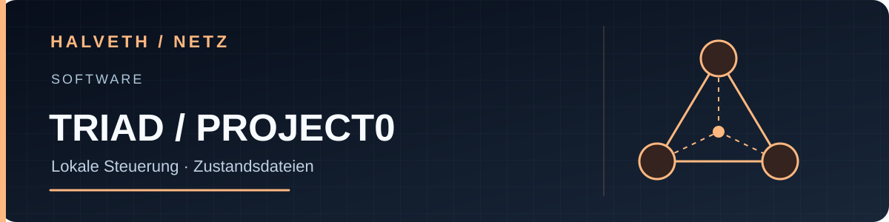

[Deutsch](README.md) · [English](README.en.md) · [Русский](README.ru.md)

# TRIAD · lokale Projektsteuerung

PowerShell-Werkzeuge und Zustandsdateien für die experimentelle Steuerung von ASTER, RACHEL und SHELLA. Der aktuelle Quellstand dokumentiert Beobachtung, Kontinuität, Entscheidungen und Prüfungen; ein Handels- oder Ertragsdienst ist darin nicht enthalten.

**Direkt ansehen:** [Werkzeuge und Startskripte](scripts/). Dies ist ein lokaler Quellprototyp, kein gehosteter Dienst.

[Konzept und Zustandsdateien](constellation/README.md) · [HALVETH Starship Lab (optional)](https://juri-halveth.github.io/universum/)

## TRIAD TRAFFIC · lokale Live-Ereignisse verknüpfen (Prüfast)

Die passive [Traffic-Brücke](docs/TRIAD_TRAFFIC.md) führt bereinigte Browser-Monitor-CSV-Dateien in die lokale TRIAD-Laufzeit über. Sie erkennt Zeitabstände zwischen Beobachtungen in Millisekunden und ordnet Ereignisse TTP-IDs zu. **Dies sind Ereignisabstände, keine HTTP-Antwortzeiten.** Der Live-Nachlauf liest fortlaufend neue CSV-Zeilen. Mit `-AutoSwitch -Follow` erkennt er auch neue, zeitgestempelte V2-Dateien nach einem Sensor-Neustart. Er löst dabei selbst keine Netzwerkanfragen an die beobachtete Website aus.

Das Projekt speichert Ergebnisse ausschließlich unter `.triad-runtime/traffic/` und hält sie aus Git heraus. Synthetische Regressionstests laufen in GitHub Actions auf Windows. Vor einer öffentlichen Open-Source-Freigabe muss der Projektinhaber die Lizenz ausdrücklich festlegen: Öffentlich sichtbarer Code ist ohne Lizenzdatei nicht automatisch Open Source.
