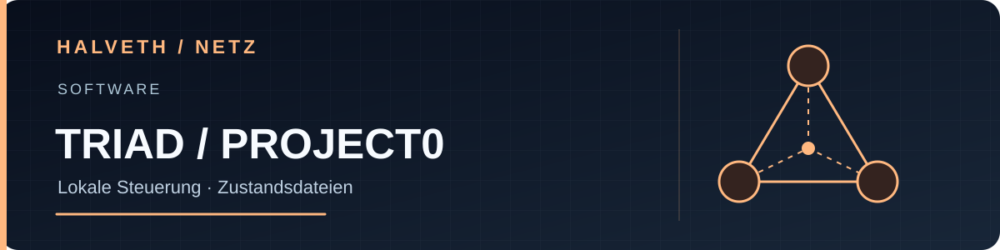

[Deutsch](README.md) · [English](README.en.md) · [Русский](README.ru.md)

# TRIAD · lokale Projektsteuerung

PowerShell-Werkzeuge und Zustandsdateien für die experimentelle Steuerung von ASTER, RACHEL und SHELLA. Der aktuelle Quellstand dokumentiert Beobachtung, Kontinuität, Entscheidungen und Prüfungen; ein Handels- oder Ertragsdienst ist darin nicht enthalten.

**Direkt ansehen:** [Werkzeuge und Startskripte](scripts/). Dies ist ein lokaler Quellprototyp, kein gehosteter Dienst.

[Konzept und Zustandsdateien](constellation/README.md) · [HALVETH Starship Lab (optional)](https://juri-halveth.github.io/universum/)



## Einen Beobachtungszyklus ausführen

Voraussetzungen sind Git und PowerShell 7. Starte im Repository einen lokalen Zyklus.

```powershell
pwsh -NoProfile -File ./scripts/Invoke-Triad.ps1 -Cycles 1
```

ASTER liest Branch, Commit und geänderte Pfade. RACHEL vergleicht den Commit mit dem zuletzt gespeicherten Zyklus. SHELLA prüft bei Änderungen den vorbereiteten und den übrigen Diff. Bei einem Commitwechsel oder einem unlesbaren früheren Stand kennzeichnet sie zusätzlich den Verlauf zur Prüfung. Das Ergebnis steht in `.triad-runtime/STATE.json`.

Der [Laufzeittest](scripts/Test-TriadRuntime.ps1) verwendet zwei temporäre Repositories. Er hält die Dateiliste gleich und verändert den Commit.
